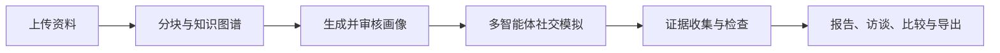

<p align="center">
  <a href="./README.md">English</a> · <a href="./README.de.md">Deutsch</a> · <strong>简体中文</strong>
</p>

<div align="center">


# 🏛️ AGORA

### 面向利益相关者、风险与情景分析的多智能体平台

**文档 → 知识图谱 → 人物画像 → 社交互动模拟 → 可追溯报告**

[版本](./VERSION) · [运行状态](./docs/STATUS.md) · [许可证](./LICENSE) · [英文说明](./README.md)

</div>

## 代码来源

本工程代码来源于开源项目 **[arn0ld87/agora](https://github.com/arn0ld87/agora)**。当前代码在其基础上增加了简体中文界面、中文内容生成、Windows 运行兼容及前端 pnpm 支持等修改。这些是当前版本的本地改动，不代表上游仓库已经包含相同功能。

Agora 的项目来源还包括 [MiroFish](https://github.com/666ghj/MiroFish) 和 [MiroFish-Offline](https://github.com/nikmcfly/MiroFish-Offline)，部分社交模拟功能使用 CAMEL-AI/OASIS。原有署名和许可信息保留在 [NOTICE](./NOTICE) 与 [LICENSE](./LICENSE) 中，工程遵循 **AGPL-3.0** 许可证。

## 项目介绍

Agora 将上传的资料转换为知识图谱，基于图谱生成可审核的人物画像，再组织智能体进行社交互动模拟，最后生成带有来源、模拟证据、假设和数据缺口的分析报告。

典型用途包括利益相关者分析、方案接受度评估、发布风险预演、沟通策略比较，以及 GraphRAG 和多智能体研究。

智能体及其发言是模型生成的模拟内容。结果用于探索可能的反应和冲突，不能当作真实民意调查或确定性预测，也不能替代真实访谈、专家评审和实证验证。

## 汉化内容

| 范围 | 当前支持 |
|---|---|
| 系统界面 | 登录页及应用内支持德语、英语、简体中文切换，选择保存在当前浏览器中。 |
| 新建运行与画像 | 可选择简体中文作为智能体语言，生成中文画像、初始帖子及模拟发言。合成的个人画像使用中文姓名；来源人物、组织保留其来源身份。 |
| 知识图谱 | 中文资料重新提取时保留中文实体名称；支持本体类型的中文显示名称，内部类型标识保持稳定。 |
| 报告 | 规划、正文、生成的自然语言元数据、质量评审及报告对话支持中文。模拟人物引用具有中文标签，内部引用标识可在详情中查看。 |
| 访谈 | 按运行保存的智能体语言回复，识别出的内部提问指令不作为用户问句展示；自动报告访谈带有来源标记。 |
| 个人资料 | 语言和报告语言可保存为简体中文；时区支持北京时间和手动采用当前系统时区。 |

界面、智能体和报告的语言分别配置。切换界面语言不会自动翻译已有图谱、画像、帖子、访谈或报告。历史数据、演示材料和部分运行诊断仍可能保留德文或英文。

## 处理流程



1. **资料与图谱**：解析 PDF、Markdown、文本等资料，分块提取实体和关系并写入 Neo4j，同时保留来源文档和文本块信息。
2. **人物画像**：根据符合条件的图谱实体生成人物画像，可以查看、编辑、审核或重新生成。
3. **社交模拟**：通过独立的 OASIS/CAMEL 子进程，模拟 Twitter 和 Reddit 风格的发帖、评论等互动。Redis 用于运行事件和实时状态传递，不需要登录真实社交平台。
4. **生成报告**：结合图谱、模拟活动和访谈收集证据，区分已验证主张、假设、数据缺口和运行限制。不完整的报告会明确标记。
5. **分析与导出**：在运行详情中查看图谱、画像、模拟、报告和访谈，并按界面提供的功能进行比较或导出。

## 技术与外部服务

| 组件 | 技术或用途 |
|---|---|
| 后端 | Flask、Python 3.14、Pydantic v2、uv |
| 前端 | Vue 3、TypeScript、Vite、Pinia、Zod |
| 知识图谱 | Neo4j |
| 实时事件 | Redis |
| 智能体模拟 | CAMEL-AI/OASIS，独立子进程 |
| 文本模型 | 按提供商连接和阶段路由选择，支持 OpenAI 兼容接口等方式 |
| 向量模型 | 单独配置 Embeddings 接口，模型维度必须与索引配置一致 |
| 元数据 | 默认文件、JSON、SQLite；PostgreSQL 为可选路径 |

本地开发需准备 Git、uv、正式版 Python 3.14，以及符合 [package.json](./package.json) 要求的 Node.js。前端使用其 [package.json](./frontend/package.json) 声明的 pnpm 版本。上游安装脚本和工程根目录的编排命令仍使用 Bun；需要使用这些命令时另行安装 Bun。

当前代码包含 Windows 兼容修复；Linux/macOS 也可使用。默认本地运行需要可连接的 Neo4j、Redis、文本模型与向量模型服务。默认存储配置不要求安装 PostgreSQL。

## 本地启动

### 1. 准备配置

在工程根目录使用中文示例 [`.env.zh-CN.example`](./.env.zh-CN.example)。已有 `.env` 时先备份并对照修改，不要直接覆盖已有加密密钥。

首次配置可在工程根目录执行：

```powershell
Copy-Item .env.zh-CN.example .env
```

填写密钥、Neo4j/Redis 连接、文本模型及向量模型地址后，再启动服务。通用配置模板为 [`.env.example`](./.env.example)，容器模板为 [`.env.docker.example`](./.env.docker.example)。

### 2. 启动后端

在第一个终端执行：

```powershell
cd backend
uv sync
uv run python run.py
```

Python 项目和虚拟环境位于 `backend/`，使用 `backend/.venv`；后端启动文件是 `backend/run.py`。环境配置文件仍放在**工程根目录**的 `.env`。

### 3. 启动前端

在第二个终端，从工程根目录进入 `frontend/`：

```powershell
cd frontend
pnpm install
pnpm dev
```

根目录和 `frontend/` 都有 `package.json`，前端依赖与开发服务应在 `frontend/` 执行。根目录 `dev` 等脚本仍调用 Bun，使用 pnpm 时按上述方式分别启动前后端。

默认前端地址为 `http://localhost:5173`，后端地址为 `http://localhost:5001`。登录页需要输入的是 `.env` 中的 **`AGORA_AUTH_TOKEN`**。

### 4. Linux/macOS 与 Docker

已有服务和配置时，后端 `uv sync`、`uv run python run.py` 及前端 pnpm 命令同样适用。上游还提供以下安装入口，具体参数见 [英文 README](./README.md#quickstart)：

```bash
./install.sh
# 或容器安装方式
./install.sh --docker
```

`install.sh` 默认从通用模板生成配置；需要中文生成时，继续按下文修改根目录 `.env`。容器中的模型目录必须使用容器内可访问的挂载路径。

## `.env` 中的中文配置

### 核心配置

```dotenv
# 新运行默认使用中文智能体语言
AGENT_LANGUAGE=zh

# 报告生成使用简体中文，与界面语言和智能体语言独立
REPORT_LANGUAGE=Simplified Chinese

# 可选：本地完整模型目录，留空则保持原有 Hugging Face 加载流程
AGORA_TWHIN_BERT_MODEL_DIR=
```

| 配置或选项 | 作用 | 注意事项 |
|---|---|---|
| `AGENT_LANGUAGE=zh` | 新建运行的默认智能体语言，影响画像、初始帖子、模拟发言和访谈。 | 支持 `de`、`en`、`zh`。新建运行或画像配置中应确认选择“简体中文”；实际运行使用保存的语言设置。 |
| `REPORT_LANGUAGE=Simplified Chinese` | 控制报告规划、正文、生成的自然语言元数据、质量评审及报告对话。 | `zh`、`zh-CN` 也可使用。默认值仍为 `German`；已有报告需重新生成。 |
| 界面语言 | 在登录页或应用顶部选择“简体中文”。 | 保存在当前浏览器中，没有对应的 `.env` 界面语言开关。 |
| 个人资料中的报告语言 | 可以保存简体中文偏好，标识为 `zh-CN`。 | 目前尚未替代报告生成使用的 `REPORT_LANGUAGE`，仍需配置 `.env`。 |
| 个人资料中的时区 | 北京时间使用 `Asia/Shanghai`，也可点击“使用系统时区”。 | 按钮采用点击时浏览器识别出的时区，再点击保存；不会持续跟随之后的系统时区变化。 |

修改 `.env` 后重启后端。已经生成或保存的内容不会自动翻译，应重新生成相应阶段或创建新运行。报告中明确指定的章节标题及原始来源证据保持原样；图谱中文显示标签不会改写内部类型标识。

### 密钥与访问配置

中文示例中的密钥为空或使用占位值，需要自行填写：

| 变量 | 用途 |
|---|---|
| `SECRET_KEY` | 应用会话签名。 |
| `AGORA_AUTH_TOKEN` | 操作员访问令牌，即登录页输入的令牌。 |
| `AGORA_SECRET_KEY` | 提供商等密钥的加密存储。 |
| `AGORA_FERNET_KEY` | API 密钥持久化的加密。 |

完成 `uv sync` 后，可在 `backend/` 目录执行以下命令生成值，每个变量分别生成：

```powershell
# 分别为 SECRET_KEY 和 AGORA_AUTH_TOKEN 生成随机值
uv run python -c "import secrets; print(secrets.token_urlsafe(32))"

# 分别为 AGORA_SECRET_KEY 和 AGORA_FERNET_KEY 生成 Fernet 密钥
uv run python -c "from cryptography.fernet import Fernet; print(Fernet.generate_key().decode())"
```

已有安装应保留原加密密钥，否则可能无法解密已经保存的凭据。真实 `.env` 和密钥不能提交到 Git。

### 模型和数据库连接

完整示例见 [`.env.zh-CN.example`](./.env.zh-CN.example)，其中地址、密码和路径均已脱敏。常用配置包括：

```dotenv
NEO4J_URI=bolt://127.0.0.1:7687
NEO4J_USER=neo4j
NEO4J_PASSWORD=replace-with-neo4j-password

EVENT_BUS_BACKEND=redis
REDIS_URL=redis://:replace-with-redis-password@127.0.0.1:6379/5

LLM_API_KEY=replace-with-llm-api-key
LLM_BASE_URL=http://192.168.1.100:4002/v1
LLM_MODEL_NAME=qwen3.8-flash-next

OPENAI_API_KEY=${LLM_API_KEY}
OPENAI_API_BASE_URL=${LLM_BASE_URL}

EMBEDDING_BASE_URL=http://192.168.1.101:8083/v1
EMBEDDING_MODEL=bge-m3
EMBEDDING_API_KEY=unused
VECTOR_DIM=1024
```

上述局域网 IP 为示例，按实际服务修改。文本模型和向量模型可以使用不同服务。`EMBEDDING_BASE_URL` 填写 `/v1` 基础地址，不填写完整的 `/v1/embeddings`；向量服务需要鉴权时填写真实 `EMBEDDING_API_KEY`，并核对模型实际输出维度。

`OPENAI_*` 用于兼容仍读取这些变量的依赖，可引用上面的文本模型配置，不需要再准备另一套 OpenAI 云服务账号。已保存的提供商连接和阶段路由还需在系统设置中确认启用；仅修改 `.env` 的初始化配置不会自动覆盖已有路由。

### 可选的本地 TwHIN-BERT 模型

社交模拟可以使用本地模型目录：

```dotenv
# Windows 示例；Linux 可填写 /opt/models/twhin-bert-base
AGORA_TWHIN_BERT_MODEL_DIR=D:/models/twhin-bert-base
```

目录应包含 `config.json`、分词器文件，以及 `model.safetensors` 或 `pytorch_model.bin` 等完整权重，分片权重及其索引也支持。配置后，模型和分词器直接从本地目录加载；配置无效目录会明确报错。相对路径以工程根目录为基准，留空则沿用 Hugging Face 缓存检查与下载方式。该模型承担模拟中的表征与检索工作，不代替生成发言的文本大模型。

## 运行参数说明

“规模与预算”中的**天数是模拟世界的计划时长，轮次是执行上限**，目前不表示“每天多少轮”。

```text
实际轮次 = min（天数 × 24 × 60 ÷ 每轮模拟分钟数，轮次上限）
```

默认每轮为 60 分钟时，3 天、24 轮仍只执行 24 轮，覆盖约 1 天；要覆盖完整 3 天，需要至少允许 72 轮。实际每轮时长以运行配置为准，预算限制和手动停止也可能提前结束模拟。

## 演示与参考案例

- [英文 README 的界面演示](./README.md#demo)：新建运行、图谱、画像、模拟和设置截图。
- [完整演示视频](./media/agora-demo.mp4)：包含图谱、模拟和报告，使用较早界面。
- [Hollerau 参考运行](./docs/reference-runs/2026-09-25-geburtshilfe-hollerau/README.md)：虚构公共服务情景及产物说明。
- [参考运行索引](./docs/reference-runs/README.md)。

仓库中的案例文档、截图和导出物是演示材料，不等于已导入你当前实例的运行记录；历史案例也不一定是中文。

## 开发与检查

在 `backend/` 目录执行：

```powershell
uv run pytest
uv run ruff check app/ tests/
uv run python -m app.contracts.dump_schemas --check
```

在 `frontend/` 目录执行：

```powershell
pnpm test
pnpm lint
pnpm typecheck
pnpm build
```

最新验证结果、已知问题和架构状态以 [docs/STATUS.md](./docs/STATUS.md) 为准，发布规划见 [ROADMAP.md](./ROADMAP.md)。运行测试或检查失败时，应查看具体原因，不要据此直接覆盖数据、跳过校验或关闭访问保护。

## 工程目录与文档

| 路径 | 内容 |
|---|---|
| `backend/` | Flask API、数据契约、业务服务、模拟脚本、迁移和测试。 |
| `frontend/` | Vue 界面、前端契约及测试。 |
| `schemas/` | 后端契约生成的 JSON Schema。 |
| `docs/` | 架构、操作指南、API、决策记录及历史参考运行。 |
| `.env.zh-CN.example` | 中文运行配置示例。 |
| `scripts/`、`deploy/`、`supabase/` | 开发检查、部署脚本和可选基础设施。 |

更多资料：[文档索引](./docs/README.md)、[架构说明](./docs/architecture.md)、[模型路由](./docs/provider-runtime-settings.md)、[升级指南](./docs/runbooks/upgrade.md)、[运行机制](./CONTEXT.md)。

当前 `VERSION` 为 `0.9.9`。关于上游发布历史和计划，以英文 README、版本文件和状态文档为准，本汉化说明不宣称新的上游发布版本。

## 安全与许可

Agora 面向单用户受控使用。开发服务默认绑定本地地址，不应直接暴露到公网；生产部署参照 [部署指南](./docs/deployment-prod-like.md)、[认证说明](./docs/auth.md) 和 [SECURITY.md](./SECURITY.md)。

当前默认 SQLite 模型配置存储中的 API 密钥可能以明文保存于 `backend/instance/llm_profiles.db`，请将该文件作为敏感数据保护。凭据、上传文档和运行产物均应按自身的数据管理要求存储和备份。

本工程继续遵循 [AGPL-3.0](./LICENSE)；原作者、上游及相关项目的署名见 [NOTICE](./NOTICE)。
